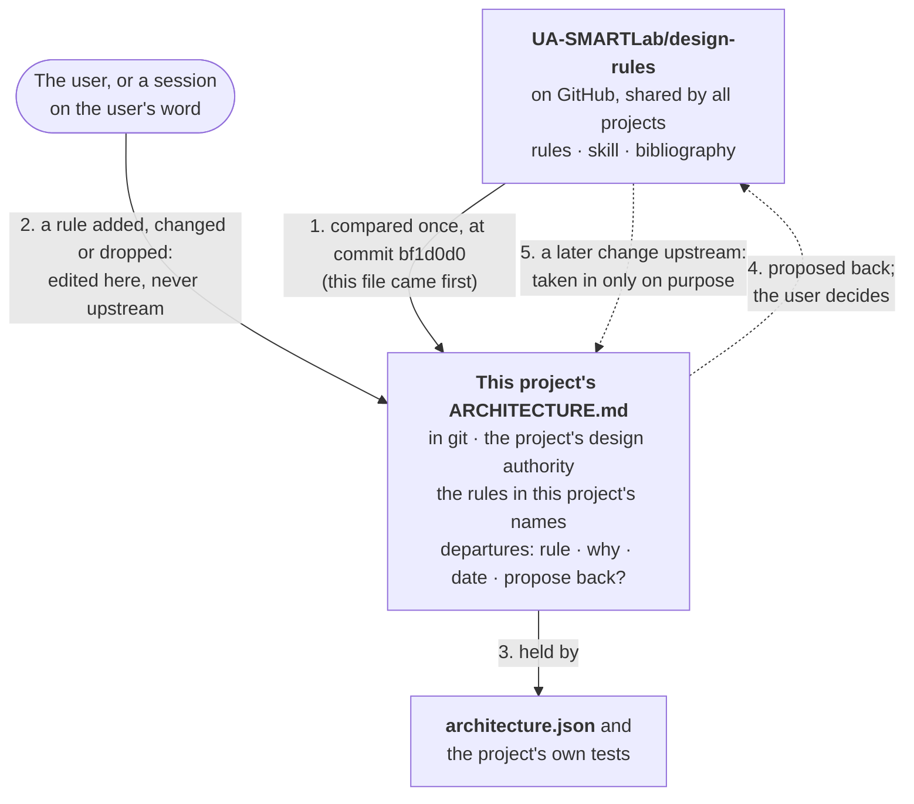

# Architecture

Library Studio is a browser app whose data is an Obsidian vault folder on the user's PC. The code is split into layers so that the analysis and the note formats can be tested without a browser, run unchanged in Node and the browser, and always write the same files.

```
            ┌──────────────── ui ────────────────┐
            │  web/ pages, src/ui/backend.js      │
            └────────────────┬───────────────────┘
                             ▼
┌─ adapters ─┐   ┌──────── services ────────┐
│ node-folder│◄──│ use cases: open library, │
│ memory     │   │ cluster, enrich, links,   │
│ browser    │   │ export                    │
└─────┬──────┘   └─────┬─────────────┬──────┘
      │                ▼             ▼
      │          ┌── ports ──┐  ┌── domain ──┐
      └─────────►│ Folder,   │  │ pure rules │
     implements  │ Http      │  │ and formats│
                 └───────────┘  └────────────┘
```

## Design authority

This file is the app's design authority. It was written on 2026-10-11, before the shared design rules
([UA-SMARTLab/design-rules](https://github.com/UA-SMARTLab/design-rules)) existed, and was compared with them at commit
[`bf1d0d0`](https://github.com/UA-SMARTLab/design-rules/tree/bf1d0d0) on 2026-11-02; since then the app changes its own rules here and never the shared ones.



Solid arrows happen every time; dashed ones only when the user chooses.

## Layers

| Layer | Folder | Contains | May import |
|---|---|---|---|
| **domain** | `src/domain/` | Pure functions: note front matter, publication notes, the clustering text pipeline (TF-IDF), the similarity graph, the graph algorithms (Leiden, Louvain, consensus, betweenness, roles, NMI/ARI, layouts), the analysis, the generated notes and presets, OpenAlex requests and enrichment, the link rule, the export (xlsx and zip writers), the co-citation phases (counting and cleaning in `co-citation.js`, the VOS methods in `vos.js`, the whole analysis in `co-citation-analysis.js`, VOSviewer files, the note and the figure). No I/O, no clock, no platform APIs; randomness only through `random.js` with a seed. | domain |
| **ports** | `src/ports/` | Interfaces the services need from outside: `Folder` (the vault), `Http` (OpenAlex). Types only. | domain, ports |
| **services** | `src/services/` | Use cases: open the library, run cluster discovery and write its results, enrich from OpenAlex, check links, export, the co-citation phases (download the citing set, look up cited works, write the maps). Receive their ports as parameters. | domain, ports, services |
| **adapters** | `src/adapters/` | The ports for each platform: Node file system (command line, tests), in-memory (tests), browser File System Access API, `fetch`, IndexedDB store of opened vaults. | domain, ports, adapters |
| **ui** | `src/ui/` | `backend.js`: the open vault, its settings, one method per tool; runs the cluster analysis and the co-citation analysis in workers (`web/cluster-worker.js`, `web/co-citation-worker.js`). The page itself is `web/` (`main.js` start screen and shell, `pages/` one module per tool, `ui.js` DOM helpers). | the public API (`src/index.js`), adapters |

The table is written for a program in [architecture.json](architecture.json), in the design rules' layering contract,
with the page's own layers beside it: `web/ui.js` and `web/help.js` (page helpers), `web/pages/` (pages), and the start
screen, the workers and the command line (boot). `npm run check` holds it: no use of a layer above or one a layer may
not use, no cycle between modules, no platform module or package in domain, ports and services (so they run in the
browser as they are), no module in no layer, no import of a file that is not there. When this table and the JSON
disagree, the JSON is what the check holds: fix this table. The dependency matrix, every module against every other:
`python ~/.claude/skills/web-app-design/scripts/check_layers.py . --page build/dependencies.html`.

## Rules

- **The vault is the contract.** File names, note formats and the presets file follow the vault's rules (its `CLAUDE.md` and `00 - Library/Library schema.md`); the citation property `cites` is written by Scoping Review Workbench and only read here. Older layouts and property names are still read, so existing vaults keep working. Text is read and written as it is: line endings are kept (the notes are CRLF on Windows).
- **Effects at the edges.** Dates, ids and file access are passed in; domain functions return values instead of writing. The analysis is a pure function of the notes and the settings (seeded randomness), so a run can be reproduced.
- **One module, one concern**, named after what it is about, with its API documented at the top.
- **Public API.** Code outside `src/` (web, bin, tests of the API) imports from `src/index.js`.

## Where it departs from the design rules

Compared on 2026-11-02 with the design rules at `bf1d0d0`, by reading the code and running `npm run check`,
`npm test` (123 pass), the design rules' citation check and a one-off search for import cycles (55 modules, none).
What agrees: the layers by the uses relation, one front door (`src/index.js`), no cycles, a pure domain (no clock or
`Math.random`; randomness only seeded through `random.js`), plain ES modules with no framework and no packages
(`scripts/build-site.js` only copies the files, no bundler), the vault's formats kept stable, light and dark themes
through CSS tokens.

None of these is worth proposing back (a suggestion; the user decides): each is work not yet done here, not a better
rule.

- **Not judged yet**: crowded views (one idea and one primary button per view) and feedback times, which need a
  person's eye on a real library rather than a measurement.

The UI was compared on 2026-11-02 in the browser pane, on the synthetic library of `tests/unit/fixtures/library.js`,
all six pages, with the measured checks of the Scoping Review Workbench's UI audit (`tests/smoke/a11y.mjs` there):
contrast, target sizes, names of buttons and fields, reflow at 320 px, each in light and dark, with transitions off.
What agrees: contrast, targets and names on every page in both themes; a visible focus outline and every page reached by
keyboard; reduced motion respected (one rule stops every animation and transition). Fixed the same day, each with its
test: white text on the green and red status colours (3.30:1 on green in light, 1.74:1 in dark) now takes the token
that reaches 4.5:1 in each theme, and no colour is written outside the tokens (`tests/unit/theme.test.js`); the
Co-citation page no longer scrolls sideways at 320 px (its grid's column could not shrink below its content, and a long
button label did not wrap); the development server listens on 127.0.0.1 only, not on every network address
(`tests/unit/serve.test.js`); headings no longer skip a level: a page's `h1`, then each card's title and each settings
group an `h2`, a heading inside a card an `h3`, the CSS following so nothing looks different
(`tests/unit/headings.test.js`; measured again in the browser, no finding on any page in either theme).

## Tests

| Kind | Where | Run |
|---|---|---|
| Unit | `tests/unit/` | `npm test` |
| Architecture | `scripts/check-architecture.js` reads `architecture.json`; `tests/unit/architecture.test.js` holds each break of the layering contract on a small project made for the test, and that this repository has none. Taken from the Scoping Review Workbench's check on 2026-11-02; the design rules' audit tool gives the same 114 uses and 0 findings | `npm run check`, `npm test` |
| README pictures | `tests/unit/readme.test.js`: every picture the README shows is there with alt text, and each animation plays once within 5 s. The animation and the light and dark screenshots are made from the app itself on the example library of the tests by `node scripts/record-readme.mjs` (headless Edge or Chrome, ffmpeg); the diagram `docs/readme/how-it-works.svg` is drawn by hand. Make them again when the look changes | `npm test` |
| Citations | `tests/unit/design-citations.test.js`: every "Author (Year)" in a bibliography, the design rules' or this project's `bibliography.json` (11 subject papers, each matched against its record on 2026-11-02) | `npm test` |

The graph algorithms have their own tests (planted partitions, comparison with the reference formulas). The whole pipeline was also compared with the Python analysis it replaces on a real library: same vocabulary, same edges and weights, identical partition.
